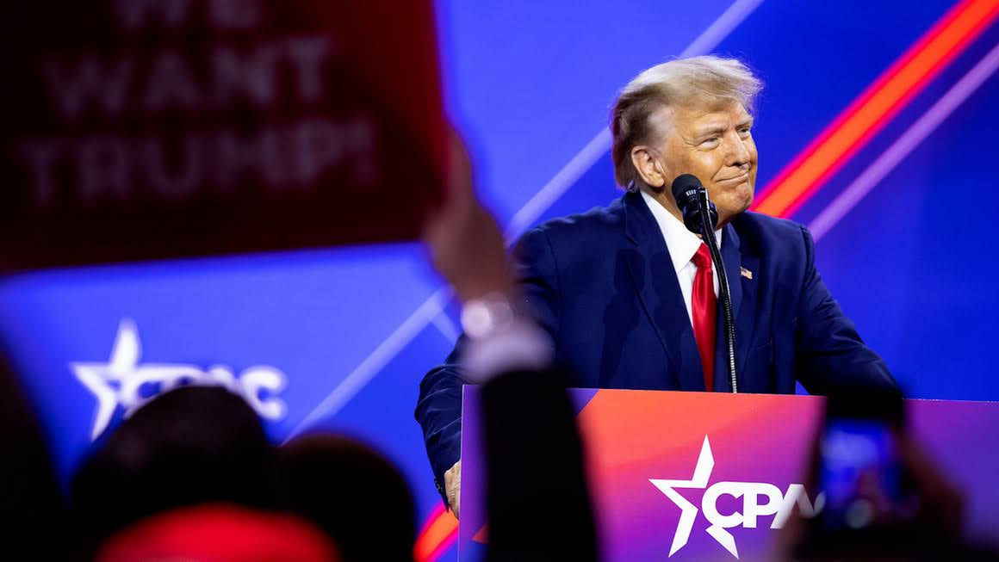

# Friction and Fall: The Resilience of Liberal Democracy and the Rise of Retributive Populism

*2026-07-17*

Let’s consider the perspective of someone who believes that a peaceful transfer of power is impossible. They are left with only two options: live under a dictatorship, or resort to violent means in an attempt to overthrow the regime. Suppose this person chooses the latter. But what if, contrary to their belief, the elections are actually fair and free of fraud? And what if a significant percentage of the population still chooses that violent path anyway?

I believe the most crucial function of democracy lies in its ability to guarantee the periodic, peaceful transfer of power. In a world plagued by election fraud, such a peaceful transition is impossible. What does a violent transfer of power actually entail? It would be an all-out brawl where prominent politicians are arrested or assassinated, and rival factions mobilize every ounce of political leverage they possess. It would devolve into a ruthless struggle over who seizes control of the military, the judiciary, the legislature, the media, and investigative agencies.

According to recent polls, 42% of the South Korean public—and notably 53% of young adults aged 18 to 29—believe that election fraud has occurred. Similarly, in the United States, only 33% of young adults in the same age group trust that elections will be conducted fairly. Regardless of whether the electoral system is actually functioning properly, the fact that a significant proportion of voters already distrust the possibility of a peaceful transfer of power indicates that the seeds of violent internal conflict have already been sown within society.

---

*2026-07-18*

I observe a tension regarding logical consistency when conservative politicians in the United States and South Korea view China's governance system.

​On the one hand, they criticize China's one-party authoritarian rule. They condemn the way private business leaders are forced to step down and disappear following unilateral notices from Beijing, the suppression of ethnic minorities, and the heavy-handed censorship of the media without any democratic process. They criticize how a single individual, Xi Jinping, rewrote the constitution to abolish presidential term limits, politically purged his rivals, and concentrated the power of state affairs entirely in his own hands.

​At the same time, however, these conservative politicians oppose the system of checks and balances—carried out by the legislature, judiciary, independent experts, and the media. They believe the culmination of democracy is when a leader like Donald Trump—supposedly representing the people's will—can have their decisions reflected in national policy without delay.

​To them, independent media and opposition parties pointing out flaws in the Trump administration's policies is not a democratic function of checks and balances, but rather a treasonous act that defies the will of the majority. Just as the Chinese Communist Party dictates to Alibaba's CEO, they view President Trump’s method of conveying demands to Silicon Valley executives through personal intimidation and connections as the secret to effective governance.

​They believe that packing the judiciary with loyalists who entirely agree with the president's agenda is a true reflection of the people's will. They even consider it a rational decision-making process to unconditionally translate the president's stance into law, even if it requires mobilizing the military to suspend the legislature.

​The U.S. Republican Party and the Chinese Communist Party may eventually realize that they share a much deeper consensus on the methodology of governance than they might think. Ultimately, as the U.S. and South Korea watch China steadily achieve its policy goals through strong leadership, they may actually seek to learn from it.

---

*2026-07-19*

For those seduced by the frictionless execution of authoritarian regimes, a fatal miscalculation often occurs. They mistake the slow, agonizing gridlock of liberal democracy for a terminal weakness. In reality, this structural friction—the annoying legal guardrails, the independent courts, and the strict limits on state power—is the exact engine that guarantees long-term civilizational supremacy.

The secret to this supremacy lies in a simple, unyielding architectural rule: a citizen does best when permitted to pursue their own interests, rather than being forced to serve the interests of their government.

When we examine the mechanics of innovation, liberal democracy drastically outperforms autocracy because it systematically protects capital rights through the rule of law. Politicians who might wish to arbitrarily intervene in private markets are constrained by institutional boundaries. This is the only reason why, in the 2000s, high-risk, unprecedented ventures like SpaceX and Tesla could secure massive amounts of financial investment from Wall Street. Investors were willing to deploy billions because they knew the state could not change the rules of the game on a whim.

This environment nurtures ambitious, risk-taking entrepreneurs who operate entirely free from government oversight. Consider Elon Musk. As an immigrant born in South Africa, he continuously uploads electrifying, politically inflammatory, and openly antagonistic messages aimed at sitting politicians on his platform, X. Despite his relentless provocations, he remains completely free from government persecution or asset seizure.

Compare this structural safety to the reality of authoritarianism. When Alibaba founder Jack Ma delivered a single speech mildly criticizing Beijing’s financial regulators, he was swiftly vanished from public life, and his corporate empire was systematically dismantled by the state. World-shifting innovation cannot survive in an ecosystem where billionaires and innovators must constantly look over their shoulders, wondering if a unilateral notice from the capital will erase them overnight.

This systemic supremacy extends beyond capital markets; it is the absolute prerequisite for cultural soft power. You cannot have BTS selling out Manhattan stadiums while running a society that sends police to measure women’s skirts or prohibits Japanese media. While strongman control might appeal to those craving order, authoritarianism inherently freezes a society's cultural software.

​If still in doubt, ask Seo Taiji. As the architect of modern K-pop, his success wasn't granted by the state; it was forged by continuously clashing with censorship boards to widen boundaries of expression. Soft power is born from untamed friction, never state-mandated conformity.

​Finally, autocracies possess a terminal economic vulnerability: a completely broken feedback loop. Because an authoritarian leader’s legitimacy relies on infallibility, there is zero incentive to correct disastrous policies if doing so damages the leader's pride.

​We witnessed this when China allowed developers like Evergrande to spiral into chaotic bankruptcy, triggering years of deflation instead of implementing a rule-bound resolution. We saw it again when Beijing stubbornly maintained Zero-Covid lockdowns long after vaccines were available. The economy was suffocated purely to ensure a perfectly controlled environment for Xi Jinping’s third-term coronation.

​In a democracy, the electorate forces politicians to fix bad policies, even if it humiliates them. In an autocracy, the government will happily let the economy burn to save face. Ultimately, the frustrating rules of liberal democracy are not a bug; they are the ultimate civilizational shield, ensuring that the ambition of the individual always outlives the ego of the state.

---

*2026-07-19*

The supreme efficiency of the democratic free market, having successfully insulated capital and accelerated frontier innovation, now arrives at its inevitable, tragic byproduct. The same architectural engine protecting billions in venture capital has funded the algorithmic obsolescence of the cognitive middle class. We are witnessing the rapid construction of a white-collar Rust Belt.

​To understand this impending political catastrophe, one must examine the precise institutional failures of the previous industrial displacement. When globalization allowed foreign manufacturing to hollow out the Western working class, the global elite offered a singular, frictionless solution: re-educate. Factory workers were instructed to adapt, learn to code, and seamlessly integrate into a new information economy.

​It was a cruel policy that treated biological reality as modular software. Human beings are finite meat. They possess rigid biological and psychological limits on their cognitive elasticity, particularly in middle age. The systemic failure of this re-education mandate did not yield a modernized workforce; it led directly to the 2010s opioid crisis, the permanent decay of regional economies, and a profound crisis of deaths of despair. In hindsight, the original Rust Belt workers were not merely failing to adapt—they were justified in their paranoia, correctly recognizing that the system had asset-stripped their futures and abandoned them.

​Today, that exact macroeconomic machinery targets the junior intellectual class. A vast demographic of young adults spent two decades executing the meritocratic social contract: absorbing immense academic pressure, mastering repetitive intelligence work, and accumulating elite credentials for the promise of middle-class stability. That promise is now unilaterally voided. Frontier AI models are systematically absorbing the entry-level cognitive labor—data analysis, legal research, low-level coding—that previously served as the economic scaffolding for young professionals.

​Once again, the institutional response is the same clinical directive: adapt, learn prompt engineering, pivot to higher-level creative strategy. It is a profoundly empty instruction. If a 45-year-old machinist could not out-compete offshore labor, a 24-year-old junior analyst certainly cannot out-train an exponentially compounding algorithm. The human brain cannot update its hardware every six months.

​The resulting psychological collapse is underway, but it will not be contained to forgotten industrial towns; it will strike the urban centers of educated youth. When a generation realizes their lifelong preparation was for a defunct economy, they do not quietly accept their obsolescence. If the economic hollowing of the blue-collar working class birthed the populist spasms of the original MAGA movement, the sudden algorithmic erasure of the cognitive middle class risks summoning a political reckoning of an entirely different magnitude. We are actively breeding a demographic of voters with elite organizational capacity, high intellectual fluency, and absolute systemic pessimism—a volatile combination guaranteeing the coming political conflict will be far more destructive than anything we have seen before.

---

*2026-07-19*

It is concerning that a significant number of people do not trust the peaceful transfer of power (text1). Conservative elites secretly want efficiency and look to the CCP (text2), but liberal democracy is more efficient (text3), which is a trap (text4). People want to tear it down (text1), and conservative politicians look to the CCP to tear it down (text2). But wait, isn't it only liberal democracy that has the ability to care about the individual (text3)? 

---

*2026-07-19*

And if you put me back in the White House, their reign is over. Their reign will be over, and they know it. And America will be a free nation once again. We’re not a free nation right now. We don’t have free press. We don’t have free anything. In 2016, I declared I am your voice. Today, I add I am your warrior, I am your justice. And for those who have been wronged and betrayed, I am your retribution. I am your retribution. Not going to let this happen. Not going to let it happen. I will totally obliterate the deep state. I will fire…

