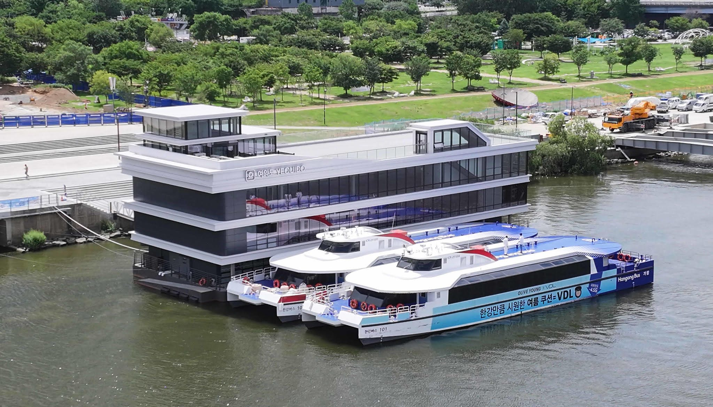

*2026-07-31*

What struck me riding the Hangang Bus yesterday was that Seoul is a city that deserves one. Watching foreign visitors up on deck, taking in the river properly, I felt a certain warmth. The Han is a beautiful river. It is an important one. From the water I looked out at the islands and structures that stand as monuments to the river's development in the 1960s and '70s — Yeouido, Bamseom, the Line 2 tracks, Jamsu Bridge, the National Assembly, the 63 Building. I watched the bridges — Mapo Bridge among them, the one from the Zion.T song — knit Seoul's core districts into a single organism. Thirty minutes on a Hangang Bus route may be the most intuitive way there is to understand this city.

That said, I don't believe the Hangang Bus can function as genuine mass transit. I'd been studying at the Maxim Plant café in Hannam-dong, and decided to take the river bus back to Yeouido simply for the pleasure of it. At 3,000 won, the fare is appealing enough that a rider might plausibly choose it over Line 6, and I don't think that pricing should be touched — any hope of revenue starts with volume, after all. But judged strictly as transit, the bus or the subway would have gotten me to Yeouido far more comfortably. Walking from Hannam-dong to Oksu Pier, the geographically nearest terminal, took forty minutes; Hangangjin Station was a three-minute walk. And I ended up catching a bus anyway to avoid missing my departure. When reaching a pier requires a transfer and a long walk, no one is going to fold the Hangang Bus into a daily commute.

The chronic deficit on the route is not the core issue. The real problem is that the riverfront has no proper retail complex to serve as a cash cow. The Oksu pier I departed from had a single CU convenience store and essentially no other commercial development around it. This separation of large-scale consumption — a Starbucks, say — from tourism-oriented transport like the river bus is the gravest flaw in the Han River's revenue structure. Consider Hong Kong. When Tsim Sha Tsui sits directly at the end of the Star Ferry pier, you can afford to absorb losses and run the service as an investment in the city's economic vitality. The Peak Tram, with a full shopping mall waiting at the summit, turns a profit on its own every year.

Building retail on that scale along the Han, however, is risky, expensive, already tainted by a failure like Some Sevit, and an easy political target. It is no surprise that the Democratic Party keeps attacking Mayor Oh Se-hoon over precisely this.

어제 한강버스를 타면서 느낀 것은 한강은 한강버스를 가질 자격이 있는 도시리는 것이었다. 선박 위에 올라서 한강의 경치를 제대로 즐기는 외국인들을 보면서 마음이 따뜻해졌다. 한강은 예쁜 강이다. 한강은 중요한 강이다. 여의도, 밤섬, 2호선 지하철, 잠수교, 국회의사당, 63빌딩과 같이 1960-70년대 한강 개발의 역사를 상징하는 수많은 섬들과 건축물들을 바라봤다. 자이언티의 노래에 나오는 마포대교와 같은 수많은 다리들이 서울의 핵심 지역들을 유기적으로 연결하고 있는 모습을 보았다. 서울을 이해하는 가장 직관적인 방법은 30분 동안 한강버스의 노선을 이용해보는 것일지도 모른다.

한편으로 필자는 한강버스가 대규모 대중교통의 기능을 제대로 수행할 수 있다고 보지 않는다. 나는 한남동 맥심플랜트 카페에서 카공을 마치고 여의도로 돌아갈 때 기분을 내기 위해서 한강버스를 이용해보기로 했다. 3000원이라는 가격은 시민 입장에서도 6호선 대신 이용할 수 있는 매력적인 가격이었다. 나는 이 가격 시스템을 바꾸면 안된다고 생각한다. 수익을 내려면 기본적으로 이용객이 많아야 하지 않겠는가? 그렇지만 대중교통의 기능으로 바라봤을 때, 나를 여의도로 더 편하게 데려다 줄 옵션은 버스와 지하철이었을 것이다. 한남동에서 가장 지리적으로 가까운 옥수선착장까지 걸어가는데 40분이 걸렸다. 반면 한강진역은 걸어서 3분이면 도착할 수 있었다. 게다가 선착 시간에 늦기 않기 위해서 버스를 이용하기도 했다. 한강버스 선착장에 도착하기 위해 버스를 갈아타고, 수십분을 걸어야 되는 상황에서 한강버스를 출퇴근용으로 이용할 수는 없다.

한강버스 노선에 만성적으로 적자가 나는 것은 문제의 핵심이 아니다. 진정한 문제는 한강변에 캐시카우 역할을 할 제대로 된 쇼핑센터가 없다는 것이다. 내가 방문한 한강버스 옥수 선착장에는 CU 편의점이 하나 입점해 있었고, 주변에 다른 인공 소비 시설은 존재하지 않았다. 스타벅스같은 대규모 소비 시설과 한강 버스와 같은 관광 교통 시설이 분리되어 있다는 것이 한강 매출 구조의 가장 중대한 문제다. 홍콩의 사례를 생각하자. 스타페리처럼 선착장 바로 앞에 침사추이가 잇으면 경제 활성화를 위해 적자를 감수하고 도시를 위한 투자의 개념에서 운영할 수 잇다. 산 정상에 대규모 쇼핑몰이 잇는 피크 트램은 매년 자력으로 흑자를 기록하고 있다.

그러나 한강변에 대규모 쇼핑 시설을 짓는 것은 리스크가 크고, 비용이 많이 들며, 세빛섬과 같이 실패해본 경험도 있고, 정치적으로 공격하기도 쉽다. 민주당이 이 주제에 대해서 오세훈 시장을 지속적으로 공격하는 것은 놀라운 일이 아니다.

