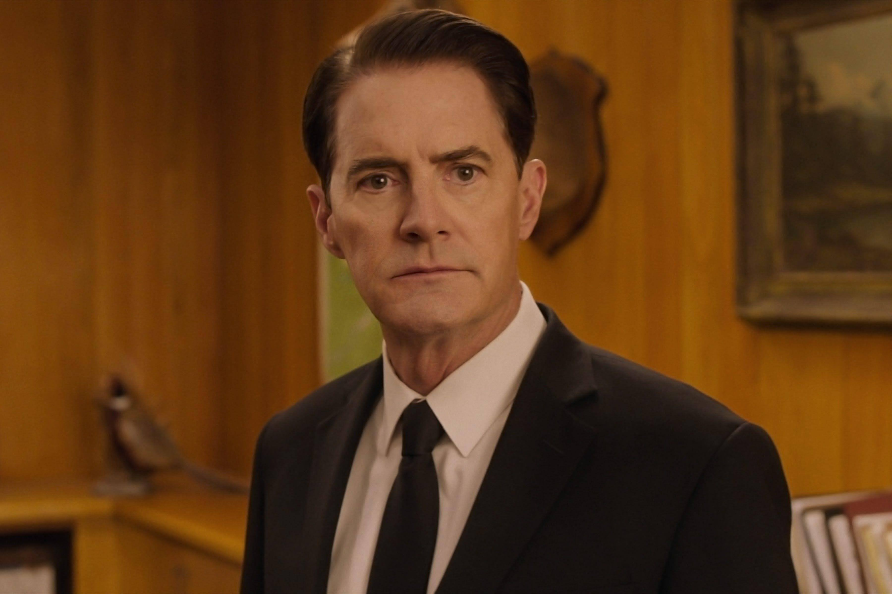

*2026-08-02*

로라 팔머는 살해당했다.  
체리 파이는 맛있다.

두 문장은 같은 세계에서 참이다. 어느 하나도 다른 하나를 취소하지 않는다. 로라의 죽음이 끔찍하다고 해서 체리 파이의 맛이 거짓이 되는 것은 아니다. 체리 파이가 맛있다고 해서 세계가 무죄가 되는 것도 아니다.

성숙한 인간은 이 둘을 하나의 씁쓸한 감정으로 적당히 화해시키지 않는다. 서로 화해하지 않는 두 진실을 함께 견딘다.

레드룸의 시선은 평온 아래 감춰진 것을 본다. 누가 희생되고 있는지, 좋은 얼굴을 한 질서가 어떤 폭력을 숨기고 있는지 묻는다. 체리 파이의 시선은 그럼에도 아직 살아 있는 것을 본다. 커피의 온기, 타인의 친절, 몸이 느끼는 작은 기쁨, 무사히 끝나는 하루를 받아들인다.

첫 번째 시선만 남으면 모든 기쁨은 위선이 된다.  
두 번째 시선만 남으면 모든 고통은 분위기를 망치는 예외가 된다.

두 시선에는 서로 다른 관할권이 필요하다.

레드룸은 현실을 심문한다.  
체리 파이는 현실 안에서 살게 한다.

심문실에서 영원히 살 수는 없다. 그러나 식당에만 앉아 숲속의 비명을 부정해서도 안 된다.

데이비드 린치의 세계에서 악은 공허 그 자체가 아니다. 인간은 누구나 유한하고, 비어 있고, 사랑하는 것을 잃을 수 있다. 타인은 내 소유가 아니며, 과거는 되돌릴 수 없고, 나는 모든 사람을 구할 수 없다. 이 사실을 받아들이면 슬픔과 애도가 남는다. 그러나 그것은 악이 아니다.

악은 그 빈자리를 견디지 못할 때 시작된다.

떠날 수 있는 타인을 가두고, 거절할 수 있는 타인을 굴복시키며, 되돌릴 수 없는 과거를 강제로 다시 쓰려 한다. 자신의 공허를 타인의 몸과 자유로 채우려 한다. 폭력은 현실이 자기 욕망과 다르다는 사실을 지워버리려는 시도다.

악인은 타인을 소유하기 위해 현실을 부정한다.  
구원자는 때로 타인을 구하기 위해 현실을 부정한다.

의도는 반대지만 위험은 같다. 타인을 독립된 인간이 아니라 자신의 결핍이나 사명을 완성할 수단으로 만드는 순간, 사랑조차 통제가 된다.

쿠퍼가 로라를 구하려다 길을 잃은 것도 그 때문이다. 그는 로라의 죽음을 기억하는 것으로 만족할 수 없었다. 이미 일어난 일을 없애야 했고, 세계의 시간을 다시 써야 했다. 그는 자신의 선함에도 한계가 있다는 사실을 견디지 못했다.

모든 비극을 바로잡지 못했다는 사실이 남아 있는 삶을 배신으로 만들지는 않는다. 로라를 기억하면서도 체리 파이를 먹을 수 있어야 한다. 그렇지 않으면 폭력은 한 사람의 생명뿐 아니라, 살아남은 모든 사람의 기쁨까지 차지하게 된다.

체리 파이의 맛은 세계가 정의롭다는 증거가 아니다. 공허가 남아 있는 세계에서도 인간이 여전히 무언가를 맛보고, 사랑하고, 함께 있을 수 있다는 증거다.

선은 공허를 없애지 않는다.  
공허 옆에 살 자리를 만든다.

모든 것을 이해하지 못해도 함께 있고, 상실을 되돌리지 못해도 기억하며, 영원히 지킬 수 없다는 사실을 알면서도 좋은 것을 보호한다.

이것은 낙관주의가 아니다. 결국 모든 것이 잘될 것이라는 믿음도 아니다. 이미 파괴된 것은 돌아오지 않을 수 있다. 정의는 패배할 수 있고, 사랑은 사라지며, 몸은 늙는다.

그런데도 지금 좋은 것은 실제로 좋다.

가치는 영원하기 때문에 생기는 것이 아니다.  
파괴될 수 있기 때문에 보호할 가치가 생긴다.

그러므로 필요한 것은 영원한 이중노출이 아니라 왕복하는 능력이다. 기억하되 계속 응시하지 않고, 즐기되 세계가 무죄라고 착각하지 않는 것. 숲에 무엇이 있는지 알면서도 다이너로 돌아오는 것.

그리고 체리 파이가 얼마나 맛있는지를 알기 때문에, 누군가에게서 평범한 삶을 빼앗는 폭력이 얼마나 끔찍한지도 더 정확히 아는 것.

로라 팔머의 죽음과 체리 파이의 맛 사이의 견딜 수 없는 거리가 바로 인간 세계의 비극이다.

동시에 그것은 우리가 무엇을 지켜야 하는지를 알려주는 척도다.

