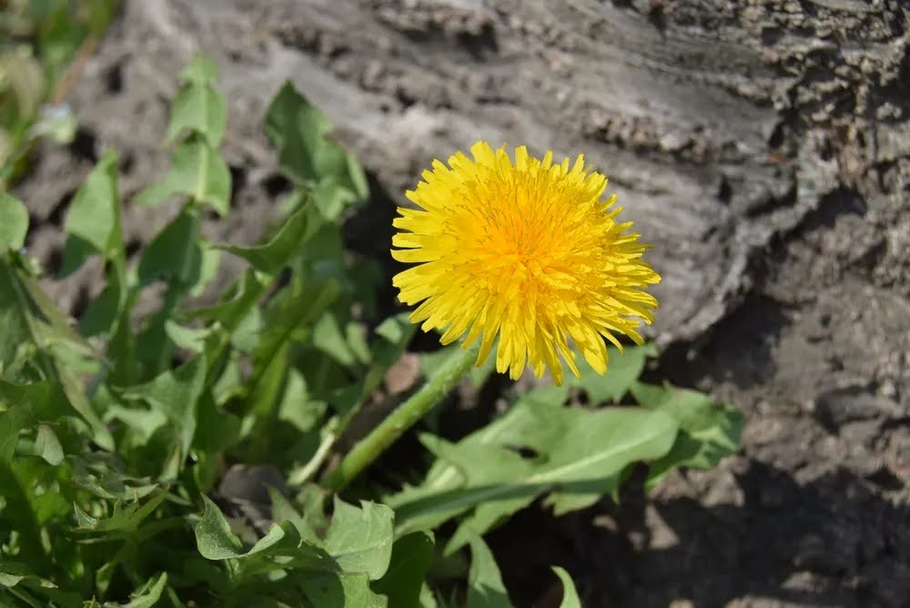

# Flowers are dumb and strong. 

That strange being, speechless,  
sharing the same ingredient of life.  
It lives on the side of the road;  
when fall comes, it produces seeds,  
and then the wind blows.

