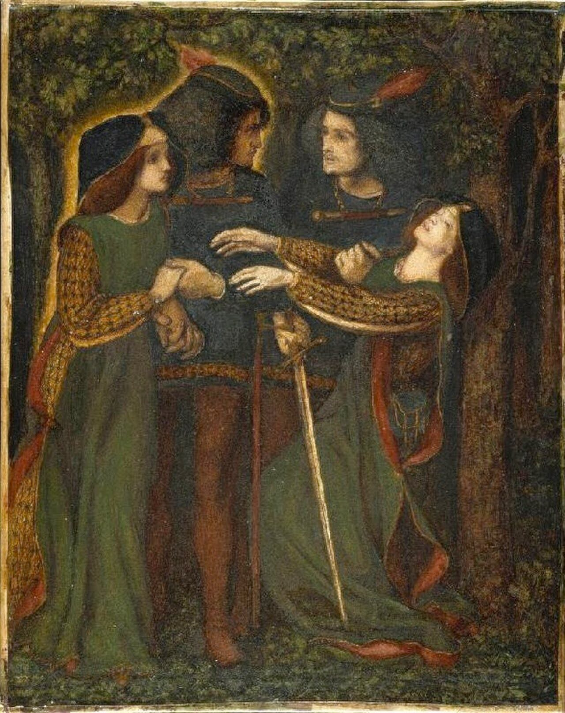

어떤 삶의 방식에 눈에 부시게  
밝은 측면이 있다면, 그 대척점에는  
정확히 같은 종류의 어둠이 있다.

같은 기전에서 발생하는  
정확히 같은 종류의 어둠이기에  
더 교묘하다.

삶의 방향성을 정한다는 것은  
나의 도플갱어의 방향성을  
정한다는 것이다.

도플갱어의 존재를  
무시하면서 눈을 감고 노래를  
부르며 지독한 어둠을 피를 흘리며  
지나본 사람이라면 안다.

나와 내 도플갱어가 한몸이라는 것을.  
내가 존재하기로 결정되는 그 순간,

나의 대척점에 있는 곳에서  
정확히 같은 종류의 도플갱어가  
태어난다는 것을.

