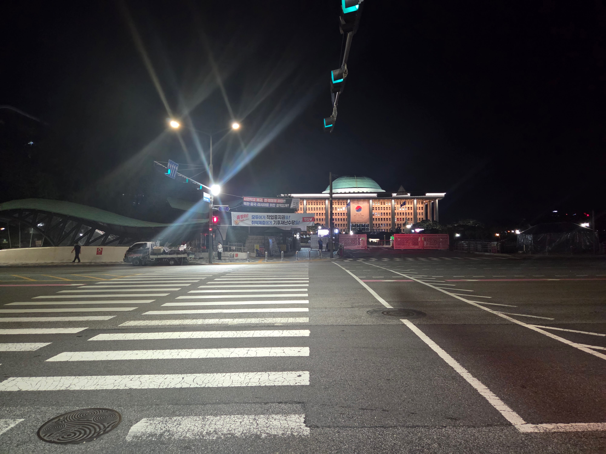

*2026-08-16*

I know in theory what it means to have a broken economy. People lose their jobs, and they live poorly under high inflation and a falling rial.  
You have every right to be mentally ill.

In Seoul, finite people live peaceful, ordinary lives. South Koreans are living just fine. I doubt we live better lives because we are better people.

I hope your body stays in comfort. It's an impossible task. When your world collapses, and when you live in a world where you cannot express your emotions honestly to the outside, you become ill. You are probably already ill. And I find that cruel.

And you have to go to work with that ill body, unlike the people here — because they ruined the economy as well as your future. In your beautiful city.

