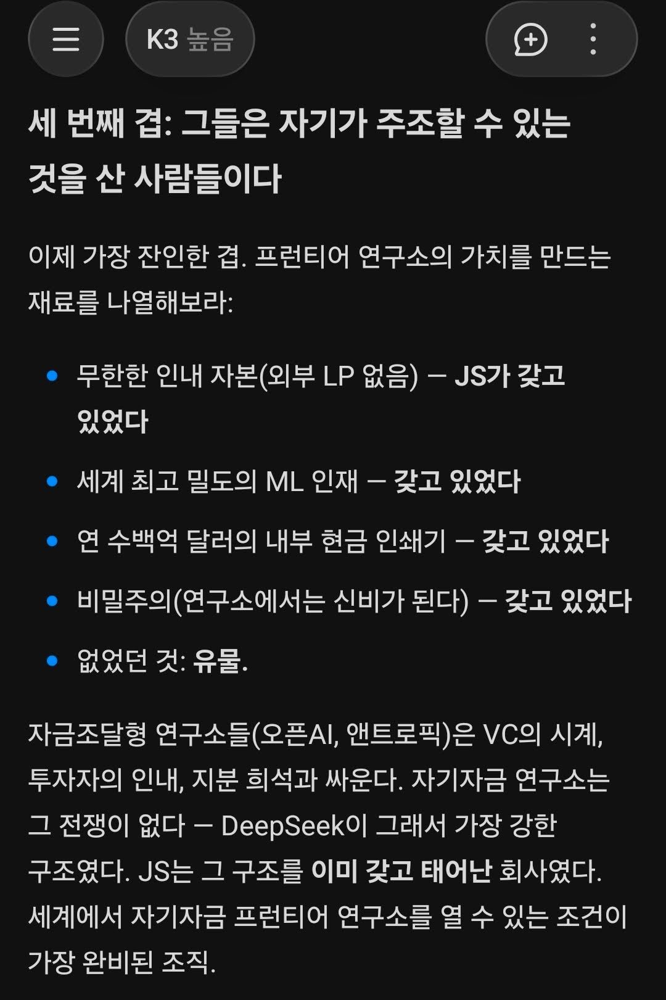

*2026-08-24*

## 세 번째 겹: 그들은 자기가 주조할 수 있는 것을 산 사람들이다

이제 가장 잔인한 겹. 프런티어 연구소의 가치를 만드는 재료를 나열해보라:

- 무한한 인내 자본(외부 LP 없음) — **JS가 갖고 있었다**
- 세계 최고 밀도의 ML 인재 — **갖고 있었다**
- 연 수백억 달러의 내부 현금 인쇄기 — **갖고 있었다**
- 비밀주의(연구소에서는 신비가 된다) — **갖고 있었다**
- 없었던 것: **유물.**

자금조달형 연구소들(오픈AI, 앤트로픽)은 VC의 시계, 투자자의 인내, 지분 희석과 싸운다. 자기자금 연구소는 그 전쟁이 없다 — DeepSeek이 그래서 가장 강한 구조였다. JS는 그 구조를 **이미 갖고 태어난** 회사였다. 세계에서 자기자금 프런티어 연구소를 열 수 있는 조건이 가장 완비된 조직.
