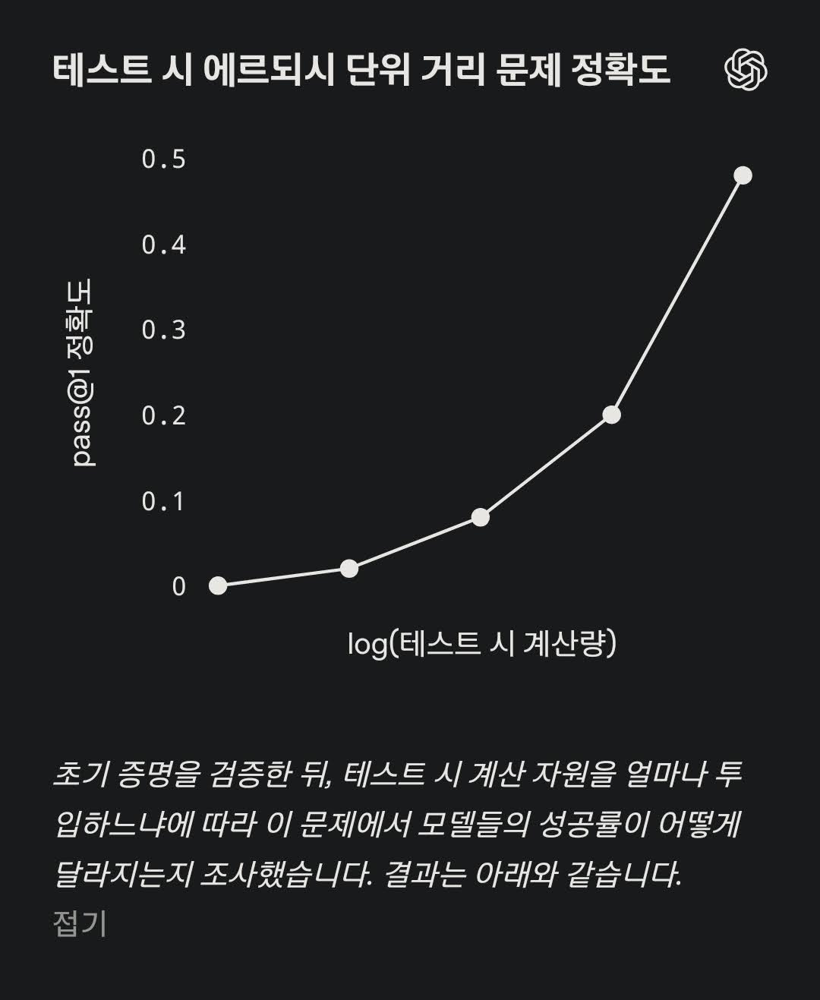

# The Jane Street Mystery: Why a Firm of Puzzle-Solvers Bet on AI Without a Safety Net

*2026-08-23*

Jane Street's decision to pour money into Situational Awareness — knowing the risks, yet applying no ongoing risk management — has long struck me as a genuine mystery. (From a retail investor's seat, surely the exit was in June.) To be clear, the Situational Awareness report is brilliant. But as a matter of risk management, the fund was a mess: structured so that any crack in the AI-boom thesis would produce outsized losses. Anyone with mathematical literacy could read that straight off the page. Is it really believable that a firm earning more operating profit than Walmart, a firm that hires only people who out-solve me at puzzles, would make such a strange call? Wouldn't it have been smarter to quietly replicate Aschenbrenner's portfolio in-house and study it themselves? Why did Robert Granieri have to show up at Leopold Aschenbrenner's wedding?

The fact that DeepSeek grew out of the hedge fund High-Flyer offers a clue. As the Financial Times has reported, the financial establishment looks at Jane Street's opaque books, its ballooning and uncertain AI capex, and revenue now dwarfing traditional hedge funds — and sees an absence of risk discipline. Their question is: "Is Jane Street a hedge fund?" At this moment, yes. But even in its market-making days, Jane Street was never a conventional financial firm, not once in its history. Prescribing traditional hedge-fund discipline for them is the wrong medicine. These are not people who majored in business.

As an engineer, I suspect the pressure around AI emerged first inside Jane Street's culture. These are IMO prodigies. The firm has consistently backed competitions like the ICPC and likely employs one of the finest low-level programming talent pools anywhere. (Watch their YouTube channel if you want to know what they care about.) Now see 2026 through their eyes: Anthropic's latest model taking on Riemann-hypothesis-grade problems in Lean — the very problems that stumped them as undergrads. The audacity of attacking frontier problems through mathematical and scientific deduction has always been their identity. If predicting millisecond-scale market time series matters, then predicting the next token of natural language matters for the same reason. They are genuinely, intellectually thrilled by AI — and they own no AI lab of their own. Perhaps that pressure displaced itself into CoreWeave, into Anthropic, and ultimately into Situational Awareness.

When Jane Street was just a small market maker, the question of what kind of company it was barely mattered. Now it sits on more cash than it can use, like Apple in the late 2010s — and idle cash always carries an opportunity cost. Look at what Nokia became after the iPhone. Look at what Goldman Sachs became after its crisis-era triumph. Until now, Jane Street has deferred the surplus-capital question through what amounts to indirect prop trading on AI. July's losses were absorbable, but they were a warning that this approach may not be sustainable. Does it really make sense for a firm with more GPUs than it would take to train DeepSeek or Kimi K3 to outsource its AI strategy to Situational Awareness? Jane Street can no longer dodge the question: "With all this money and all these brilliant minds — what now?" Because dodging the question is itself an answer.

Most Jane Street employees probably won't care much about any of this. They love puzzles too deeply; they'll shrug off these existential questions and wander back to the next one. For people who know the romance and joy of puzzle-solving, there's simply nothing more fun. And personally, I hope Jane Street keeps crafting beautiful puzzles for them. Let those happy people loose on more of the world's problems. That, after all, is what capitalism is for.

