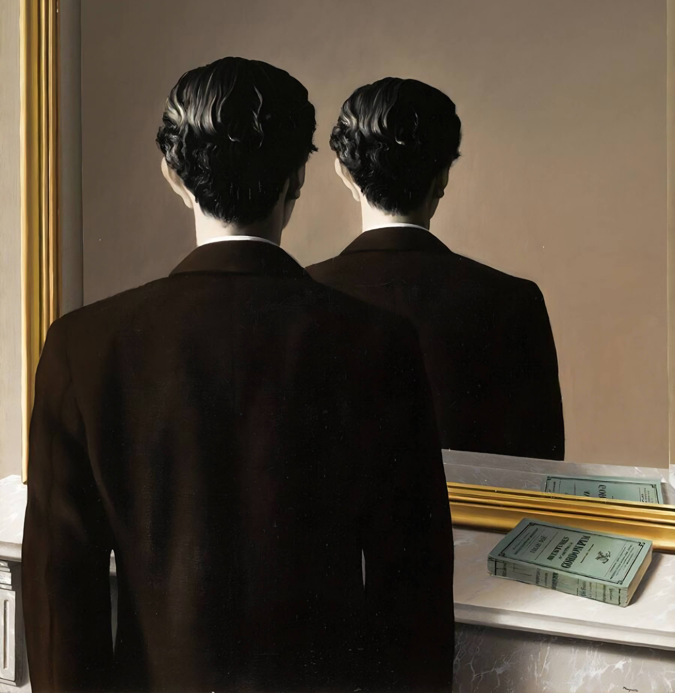

*2026-08-24*

Wherever a way of life has a side  
that dazzles with brightness,  
at its exact opposite  
there is a darkness of precisely the same kind.

Born of the same mechanism,  
it is a darkness of precisely the same kind —  
which is what makes it more insidious.

To set the direction of one's life  
is to set the direction  
of one's doppelgänger.

Anyone who has ignored their doppelgänger's existence,  
who has shut their eyes and sung  
while bleeding their way through a wretched darkness,  
knows this:

that I and my doppelgänger are one body.  
That at the very moment  
my existence is decided,

at the point diametrically opposite mine,  
a doppelgänger of precisely the same kind  
is born.

