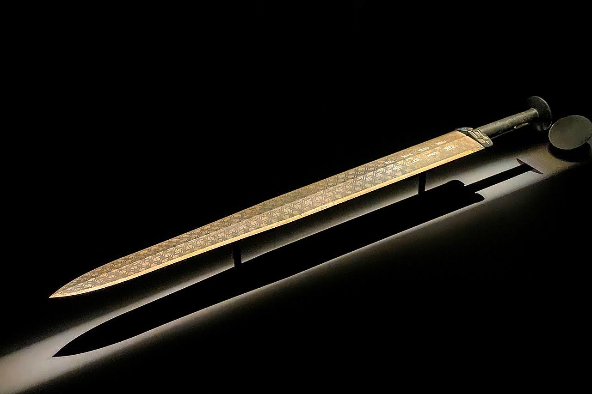

세상을 해부하는 건 검을 휘두르는 법을 배우는 것이라고 생각한다. 검술을 처음 익히는 과정에서는 일단 가게에서 칼을 하나 구매한 다음, 그 칼로 무엇을 어떻게 찔러야 할지를 이곳저곳 수소문하며 연습해보게 된다. 시간이 지나 검술을 어느 정도 익히면 무엇을 찌를 수 있는지를 서서히 느끼게 된다. 본능이 이끄는대로 강하게 몇 번 찔러보고 나면 비로소 알게 된다. 자신의 검으로 정확히 어디까지 찌를 수 있는지를. 그리고 세상에는 찔러서는 안되는 것도 존재한다는 사실을.

찔러보고 나면 알게 된다. 진짜 찔린다는 걸. 검술을 처음 익히는 단계에서는 상상도 할 수 없는 일이다. 그런데 그 시점은 검술이 어느 경지에 달할 때까지는 안 온다. 찔러본 적이 없는 사람은 자신이 죽인 시체 앞에 서본 적이 없는 사람이기 때문에. 진정한 검객은 세상이 끔찍할 정도로 취약하다는 것을 안다. 세상이 너무나도 쉽게 휘어진다는 사실을, 자신이 단한번의 동작만으로도 세상을 멸망시킬 수 있다는 걸 안다.

검을 휘두르는 사람이 주의해야 할 것은 오로지 자기 자신 뿐이다. 칼은 자신의 영혼으로 만들어져 있다. 칼로 누군가를 찌른다는 것은 높은 확률로 자기 자신을 정확히 같은 방법으로, 혹은 정확히 정반대의 방법으로 찌를 수 있다는 것을 의미한다. 찌를 수 있는 대상은 도처에 널려 있다. 칼을 들기로 한 그 순간에는 자신이 찌르는 대상에 대해 면밀히 분석하는 것만큼이나, 이 대상을 찌르는 행위가 자기 자신에게 정확히 무슨 의미인지를 규명하는 것이 중대한 과제가 된다.

