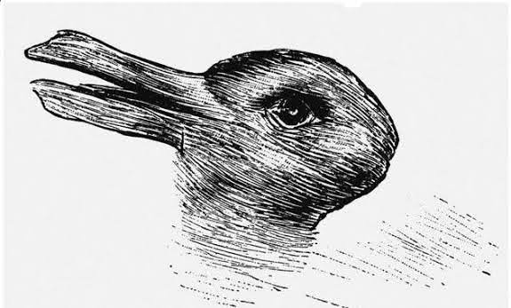

# 언어. 세계모델. 세계

언어 <---> 세계모델 : 세계

세계모델과 세계 사이의 간극

===

언어

가상의 세계를 창조할 수 있는  
논리적 도구를 제공함  
-> 언어적 기술이라는 시뮬레이션을 통해  
사회 구조의 맹점을 연산할 수 있음.

===

간극을 잘 매우는 시스템  
간극을 잘 못 매우는 시스템

===

사회의 간극에 대한 대응 방식  
1. 구조적 분석 : 간극 평화적 해소 (음성 피드백)  
2. 상향식 혁명 : 불확실  
3. 수평적 전가 : 간극 폭력적 증가 (양성 피드백)

민주주의 : 정기적인 상향식 혁명으로 간극을 좁힘  
권위주의 : 독재자의 임기와 함께 간극이 누적됨

===

식민주의

세계모델을 만드는 주체와  
현실을 사는 주체가 분리  
-> 인지적 간극이 커지는 구조

수평적 전가 -> 대규모 학살 (피드백 루프의 부재)

====

정치 체제 (=서사) 의 위계 : 지속가능한가?

-> 인지론적 간극을 잘 매우는가?  
     -> 피드백 루프가 강한가?  
     -> 개방적인가/폐쇄적인가?  
     -> 모델이 설명력이 높은가?  
          -> 복잡성이 충분히 높은가?

-> 세상을 바꾸는가?  
      -> 낙관적인가/비관적인가?  
      -> 사람들을 설득할 수 있는가?  
      -> 사람들에게 권한이 있는가?

-> 좋은 목적지를 가지고 있는가?  
     -> 인간의 고통을 줄이는가?

====

수평적 전가

간극의 원리가 복잡해서 이해가 어려움  
-> 음모론 / 비언어적 설득  
     / 국가 폭력과 검열 / 특정 집단의 문화로 연결  
-> 수평적 전가  
-> 논리적 모순은 해소되지 않음

선택되는 이유

1. 단순한 세계모델 -> 마음의 안정  
2. 상향식 혁명의 큰 비용  
3. 타격감이 큰 Meme -> 재미있음

===

언어에서의 고통의 표현

1. 세계모델의 오차 보정 과정의 기록

많은 경우 고통은 자신의  
세계모델을 현실에 가깝게 만들기  
위해 오차를 줄이는 과정이 포함됨.

언어는 세계모델과 연결되어  
있기 때문에 세계모델이 현실에  
가까워지는 과정에서 출력되는  
언어적 결과물이 있음.

2. 물리적 고통에 대한 세계모델

물리적 고통에 대한 세계모델을  
위한 단어들이 언어 안에 내장되어 있음.

그러나 그것은 실제 고통의 경험과  
잘 연결되지는 않음

===

고통이 문학적으로 중요한 이유는  
(1)과 (2)가 intertwine 되기 때문이다.

고통을 의미있게 만드는 역할은  
세계 모델을 업데이트하는 것이다.

===

언어라는 도구는  
고통을 하나의 세계모델로  
묘사할 때보다 (2)

세계모델이 변형된 과정에서의  
고통이나 혼란을 기록할 때 (1)  
더 잘 작동함

그것이 언어의 한계

(1)번 스타일의 고통의 묘사는  
개인적 차원을 넘어 사회적 차원으로도  
확장하기 용이함.

===

인간의 세계모델은 수렵 채집 시대의  
1. 사회적으로 단순하고 -> 개인적 폭력 (주체적)  
2. 환경적으로 복잡한  

야생적 세계관에 기초한다.

현대 사회는  
1. 사회적으로 복잡하고 -> 사회적 폭력 (대리적)  
2. 환경적으로 단조롭기 때문에  

인긴의 세계모델과 본질적으로 충돌한다.

===

개인적 폭력 : 의사결정과 행동의 주체가 같음 (주체적)  
-> 세계 모델과 현실 사이 간극이 작아짐  
-> 협상 쉬움

사회적 폭력 : 의사결정과 행동의 주체가 다름 (대리적)  
-> 세계 모델과 현실 사이 간극이 커짐  
-> 협상 어려움

===

카리스마적 리더십  
-> 세계 모델이 단순 (나의 말이 다 맞다)  
-> 인간의 본래 세계 모델과 유사 (낮은 연산 비용)

중산층과 자유민주주의 사이의 상관관계  
: 복잡한 세계 모델을 유지하기 위해  
안정된 연산력이 필요

===

사회적 폭력은 의시결정과  
행동의 주체가 다르기 때문에 협상이 어렵다

독재자의 개인적 폭력 -> 정권 교체로 해결

사회 전체의 인식론적 모순  
-> 정권 교체로도 폭력의 압력이 남음

===

철학과 문학의 역할

1. 잘못된 세계 모델 -> 논리적 모순의 유도 -> 반증  
2. 더 상위의 세계 모델 구축

===

언어로 구성된 세계 모델 안에 논리적 모순이 있으면  
문학은 그 세계 모델을 있는 그대로 가동해  
논리적 모순을 가차없이 폭파시켜 버린다.

논리적 모순이 존재한다는 것은 세계 모델과  
세계 사이에 간극이 존재한다는 것을 의미한다.

그것은 우리 세계 모델이 개혁되어야 한다는 것을  
그리고 그 세계 모델에 전제되어 만들어진  
정부 시스템을 모두 다 개혁해야 한다는 것을 의미한다.

===

고통의 중요한 부산물 역시  
세계 모델의 업데이트이기 때문에  
고통과 문학은 깊은 연관성을 가지게 된다.

===

인간은 세상을 더 잘 설명하기만 한다면  
오히려 복잡한 모델을 받아들이는 것을 좋아한다.

왜냐면 복잡한 모델은 한번 이해하기는 어렵지만  
일단 이해하면 단순한 모델보다 적용이 쉽고  
검증과 발전이 잘 되기 때문이다.

괜히 머리가 아픈 뉴턴 역학을  
사람들이 기를 쓰고 공부하는 것이 아니다.

===

냉소하지 말고  
계산하라.

아는 자가 냉소하면 -> 세상을 구할 정확한 세계 모형을 만들지 않음  
모르는 자는 절망한다. -> 세계 모형이 없는 상태에서 세계에 던져짐  
절망하는 자는 분노한다. -> 자신의 단순한 세계 모형에 현실을 억지로 구겨 넣음  
분노하는 자는 파괴한다. -> 세계 모형은 현실에서 더 멀어지고 그 간극은 폭력으로 채워짐.

파괴를 기다리는 것은 범죄다.  
건설하라.

