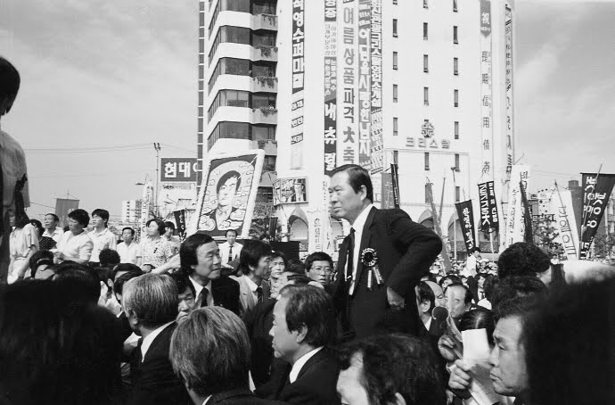

# Repentance Is Not Resistance

*2026-09-06*

Does the German intellectual world have a manual for explaining why the Nazis were evil, but no plan at all for how to stop them from rising — or what to do once they have?

They have shouted the historical lesson for decades: that the Nazis took the Weimar Republic through legal elections and political bargains. And yet, with the fortress of the constitution being stormed from within by the very same method in the twenty-first century, what do they offer? Only a passive refusal — we will not ally with them, the firewall — and constitutional safeguards that the AfD's rising support is slowly rendering inert. The enemy is pulling down the walls, and they stand inside the gate, locking the door tighter, shouting that they are keeping to their principles. This is not a plan. It is closer to collective suicide.

In admitting the crimes of their past, they have changed. In failing to produce the inspired madman of a politician who could change the world before the Nazis arrive, they have not changed at all. Do they intend to reform anything? If they miss the timing and lose the power of Europe to the far right, who will defend Ukraine and European liberal democracy?

"The fight is here; I need ammunition, not a ride"
— Volodymyr Zelenskyy, 2022

If the AfD takes power tonight in Sachsen-Anhalt, Germany must finally admit that it learned nothing from the past. Ask them about the Second World War, and they think only of themselves in their ugliest, cruelest hour, and sink into a terrible fear and guilt. But they have not changed. German society succeeded in repenting for its history. It failed to learn the responsibility, the mission, the pride of imagining a new world that holds human dignity. Consider what was in the hearts of those who took up arms against the Nazis. Did they believe in statutes? Did they believe in the system? Were they humble? Did they believe they would survive the war? They were noble, savagely optimistic madmen and rebels. Can the German intellectual world really not tell a Nazi from an anti-Nazi resistance fighter?

"A revolutionary never dies in his bed. I too will die in the very heart of Seoul. Even if your father falls in the middle of the street, you must not weep. Do not weep — you must rise and fight…"
— Lyuh Woon-hyung, 1947

"No matter how hard you wring the rooster's neck, we must never forget that the dawn will come!"
— Kim Young-sam, 1979

"It is about the psychology of human action — of social man, of political man. You could also call it the posture one ought to take. It means: act. Act. And in acting, depending on the situation, you can link arms, throw your shoulders together, go out and demonstrate and fight. And if there is truly nothing else you can do, then shout past the wall from inside your own house. It will have no effect. But I am expressing myself, I am confirming the sense of justice within me, the indignation within me, my own stance — so live as a living person. That is what it means. Do not live as a dead man; live as a living one. Then someday an opportunity may come, and you may be able to fight better. So do not give everything up and run away and hide… Be a living human being, a human being whose mind is on fire. Whether it works or not may be a matter for later."
— Kim Dae Jung, 2009

If Germany has learned nothing from the past, it is because they memorized only the conclusion — the Nazis were evil — and wholly forgot the essence: what kind of mad courage and sense of mission it takes to defend human dignity when such a monster moves to swallow the world. Nazism is not merely a result, the worst political system in human history. It is the mechanism itself — how easily the masses slide onto the trajectory of destruction once human beings lose the vitality of the soul and the noble narrative.

What is needed to stop the Nazis is not a thicker legal fortress, nor an endless confession of guilt. It is the existential revolt of living madmen — those who put down their cynicism before an absurd reality, and arm themselves with the joy of building a new world and a ferociously optimistic mission toward human dignity. If Germany cannot grasp this essence, and still clings to its manuals for dissecting the memories of the past, it will sink once more before the history of 2026.

---

참회는 저항이 아니다

독일 지성계는 나치가 왜 나쁜지에 대해 설명하는 것에는 메뉴얼이 잇지만, 나치의 등장을 어떻게 막을지, 등장한 다음에 뭘 해야하는지에 대해서는 대책이 없는 것 아닌가?

나치가 합법적인 선거와 정치적 거래를 통해 바이마르 공화국을 접수했던 그 역사적 교훈을 그토록 외쳐놓고도, 정작 21세기에 똑같은 방식으로 헌법의 성채가 내부에서부터 함락당하는 것을 눈앞에 두고서 그들이 내놓는 대책이란 오직 "우리는 그들과 연합하지 않겠다(방화벽)"는 소극적 거절, 그리고 AfD의 높은 지지율로 인해 서서히 무력화되고 있는 헌법적 안전장치 뿐이다. 적들이 성벽을 무너뜨리고 들어오는데 성문 안에서 문을 더 단단히 잠그며 "우리는 원칙을 지키고 있다"고 외치는 이 무책임함은 대책이 아니라 집단 자살에 가깝다.

역사적 과오를 인정한다는 측면에서는 바뀌었지만, 나치가 등장하기 전에 세상을 바꿀 영감을 주는 미치광이 정치인을 배출하지 못했다는 측면에서는 전혀 바뀐 것이 없다. 이들은 개혁을 할 생각이 있는가? 그들이 타이밍을 놓쳐서 유럽의 권력을 극우에게 뺏기게 된다면, 우크라이나와 유럽의 자유민주주의는 누가 지킬 것인가?

"The fight is here; I need ammunition, not a ride"
- Volodymyr Zelenskyy, 2022

오늘 Sachsen-Anhalt 주에서 AfD가 집권하게 된다면 독일은 인정해야 한다. 그들이 과거로부터 배운 것이 없다는 것을. 2차 세계대전에 대해서 질문하면 그들은 추악하고 잔인했던 시절의 자신의 모습만을 생각하면서 지독한 공포와 죄책감에 빠진다. 그러나 그들은 바뀌지 않았다. 독일 사회는 과거사에 대해서 반성하는데는 성공했지만, 인간의 존엄을 지키는 새로운 세상을 사유하는 책임감과 사명, 자부심의 가치를 배우는 데 실패했다. 2차 세계대전에서 나치에 맞서 총을 든 세력의 마음 속에 무엇이 있었을지를 생각해 보라. 그들이 법조문을 믿었는가? 그들이 시스템을 믿었는가? 그들이 겸손했는가? 그들이 전쟁에서 살아남을 수 있을 것이라고 스스로 생각했는가? 그들은 고귀한, 지독할 정도로 낙천적인 미치광이 반항아들이었다. 독일 지성계는 정말로 나치와 반나치 레지스탕스를 구분할 수 없는가?

"혁명가는 침상에서 죽는 법이 없다. 나도 서울 한복판에서 죽을 것이다. 아버지가 길바닥에서 쓰러질지라도 너희들은 울지 마라. 울지 말고 일어나서 싸워야 한다..."
- 여운형, 1947

"아무리 닭의 모가지를 비틀지라도 새벽이 온다는 것을 잊어서는 안 됩니다!"
- 김영삼, 1979

"인간의…사회적 인간 또는 정치적 인간들의 그 행동의 심리를 말하는 거겠죠. 취해야 할 자세를 말하는 것이라고도 말할 수 있고, 행동하라는 거예요. 행동하라. 행동하되 경우에 따라서는 팔짱끼고, 어깨를 걸고, 밖에 나가서 데모도 하고 싸울 수도 있고. 정 할 것이 없으면은 집에서 담벼락 밖으로 소리질러라. 아무 효과 없다. 그러나 나는 나를 표현하고 있고 내 마음속에 정의감 또 내 마음속에 울분 나의 자세 이런 것은 확인하면서 산 사람으로서 살아라 이런 얘기지. 죽은 사람으로 살지 말고 산 사람으로서 살아라. 그러면 언젠가 기회가 올 수도 있고 좀 더 낫게 싸울 수도 있고, 그러니까 모든 것을 포기하고 도망가고 숨어버리고 이러지 말고… 살아있는 인간, 머릿 속이 타오르는 인간. 효과가 있고 없고는 또 다음 문제일 수도 있는 거예요."
- 김대중, 2009

독일이 과거로부터 배운 것이 없다면, 그것은 그들이 '나치는 나쁘다'는 결과만 암기했지, '나치 같은 괴물이 세상을 집어삼키려 할 때 인간의 존엄을 지키기 위해 어떤 미치광이 같은 용기와 사명감이 필요한지' 그 본질을 완전히 망각했기 때문이다. 나치즘은 단순히 '인류 역사상 가장 나쁜 정치 체제'라는 결과물이 아니다. 인간이 영혼의 활력과 고귀한 서사를 잃어버렸을 때 대중이 얼마나 쉽게 파괴의 궤적으로 미끄러지는가에 대한 경고 그 자체다.

나치를 막기 위해 필요한 것은 더 두꺼운 법적 성채나 끝없는 죄책감의 고백이 아니다. 그것은 부조리한 현실 앞에서 냉소를 거두고, 새로운 세계를 짓는 건설의 즐거움과 인간의 존엄을 향한 지독한 낙천적 사명감으로 무장한 '살아있는 미치광이들의 실존적 반항'이다. ​독일이 이 본질을 깨닫지 못하고 여전히 과거의 기억을 해부하는 매뉴얼에만 매달려 있다면, 그들은 2026년의 역사 앞에서 또다시 침몰할 것이다.

