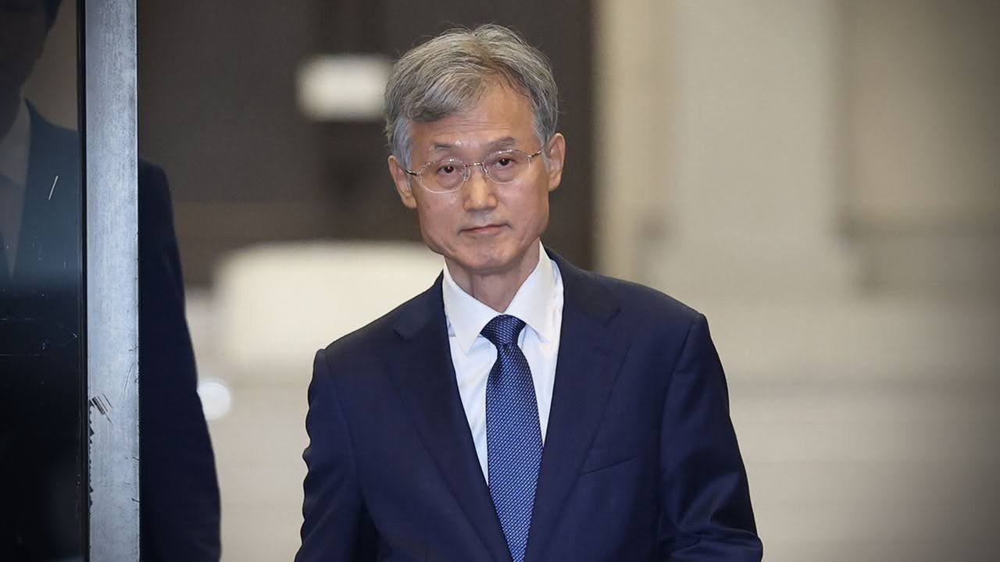
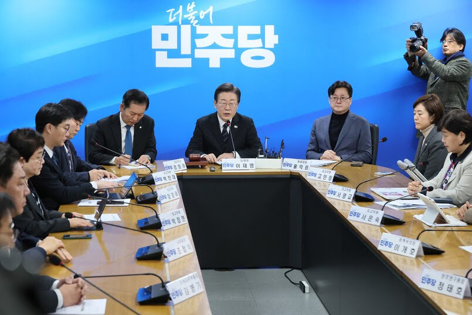

**Who Chooses South Korea’s Supreme Court?**

*2026-09-23*

Chief Justice Cho Hee-dae’s refusal to submit a new Supreme Court nominee can be defended in the name of judicial independence. But judicial independence does not give the judiciary a monopoly over the composition of the Court.

The Constitution gives the Chief Justice the power to recommend justices, not to appoint them. The National Assembly must consent, and the president must appoint. Every appointment therefore requires the participation of three constitutional actors. Nor does the Chief Justice choose from an open field: a ten-member recommendation committee first produces a shortlist whose recommendations he is required to respect.

Cho’s conduct throughout this appointment process makes an absolutist interpretation of the Chief Justice’s recommendation power difficult to sustain. The committee named four candidates to succeed Justice Roh Tae-ak on January 21. Yet Cho did not recommend Son Bong-gi until August 18, 209 days later. Roh had already retired in March. For months, the recommendation remained pending while the Supreme Court and the presidential office tried, and failed, to agree on a candidate.

That sequence matters because the Constitution does not allow any one of the three actors to complete an appointment alone. Its structure does not eliminate conflict; it makes each institution dependent on the others even when conflict occurs. Cho himself acted within that structure for months, treating presidential acceptance as important enough to postpone his recommendation while negotiations continued. But once agreement became impossible, he submitted Son’s name unilaterally and, after the president rejected him, refused to recommend anyone else.

Cho cannot have the argument both ways. If presidential acceptance had no substantive role in the process, the 209-day pursuit of an agreement is difficult to explain. But if the Constitution requires each institution to exercise a meaningful part of the same appointment process, the Chief Justice cannot respond to disagreement by, in effect, treating his own choice as final and leaving the seat vacant until the other institutions yield.

===

President Lee Jae-myung’s demand that the Chief Justice submit a new recommendation for the Supreme Court raises a fundamental question: how much substantive force should be given to the Chief Justice’s constitutional power to recommend Supreme Court justices for appointment?

One important constitutional-historical argument for interpreting the president as having a substantive power to reject such a recommendation can be traced in part to the 1972 Yushin Constitution. The 1962 Constitution explicitly stated that, once the Chief Justice recommended a Supreme Court justice, the president “shall appoint” that person. The Yushin Constitution deleted that language, and it has never been restored in subsequent constitutions, including the Constitution currently in force.

Meanwhile, under legislation passed under the leadership of the Democratic Party, the Court will grow from 14 members, including the Chief Justice, to 26. By the end of his term, President Lee will have appointed 22 members of the Supreme Court, including the Chief Justice. Of those 22, 21 require a recommendation from the Chief Justice.

The present confrontation, therefore, is not merely about Son Bong-gi. Depending on how far the president’s power to reject a recommendation is recognized, the substantive balance of power between the president and the Chief Justice could be reshaped across the Supreme Court appointments that remain during Lee’s term.

A clause removed by the Yushin Constitution half a century ago—at a time when presidential power over the judiciary was being strengthened—has now returned as a constitutional argument in support of the appointment power of a Democratic Party administration.
