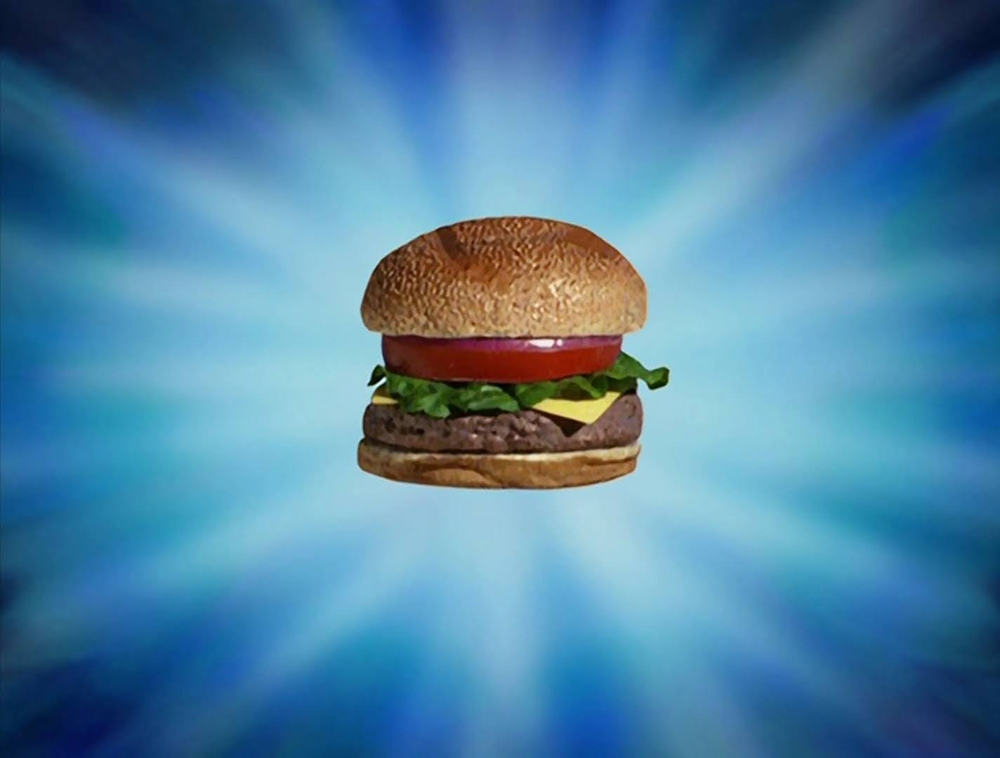

# The Krabby Patty Is Not Just a Burger

Squidward treats SpongeBob as an idiot while free-riding on perhaps the most productive worker in Bikini Bottom. SpongeBob cooks at extraordinary speed, maintains absurdly high standards and appears incapable of losing enthusiasm for repetitive labour. Squidward operates the cash register and complains.

Still, SpongeBob is too strange to be respected simply as a competent employee. His productivity is inseparable from the traits that make him unbearable: obsessive enthusiasm, total identification with his work and an almost pathological inability to disengage from it. An Elon Musk type, perhaps, if Elon Musk lived in a pineapple and found spiritual fulfilment in operating a grill.

But this raises a larger question.

Why does the grill matter so much?

The conventional explanation is that the Krabby Patty is merely a successful hamburger and Plankton wants its secret formula because the Chum Bucket is failing.

That explanation becomes difficult to sustain once one considers Plankton.

Plankton is one of the greatest scientists in Bikini Bottom. He builds robots, artificial intelligence, mind-control devices and machines far beyond the apparent technological level of the society around him. Yet he devotes an extraordinary proportion of his life to stealing a restaurant recipe.

Either Plankton is much stupider than his inventions suggest, or the Krabby Patty is much more important than it appears.

The second possibility deserves consideration.

===

Recipes are information, and information can be worth far more than the object that carries it. The Krabby Patty formula may be more than a list of ingredients. It may embody some principle of chemistry, biology or matter organisation that Bikini Bottom discovered only once—and does not yet understand.

Nor is Plankton the only reason to suspect that the Krabby Patty is more than it appears. Mr Krabs guards the formula obsessively, customers display extraordinary attachment to the product, and nobody seems able to reproduce it reliably.

Perhaps Plankton is not irrationally obsessed with a hamburger.

Perhaps he has already done the calculation.

The Krabby Patty may be something like a physical singularity in the SpongeBob universe: an apparently ordinary object around which an implausible amount of economic, technological and social behaviour bends.

Everyone else sees lunch.  
Plankton sees the anomaly.

SpongeBob, meanwhile, may be the only person capable of reproducing the phenomenon reliably without understanding what it is.

Mr Krabs owns it.  
Plankton understands its significance.  
SpongeBob knows how to produce it.

And Squidward works three metres away, wondering why he is surrounded by idiots.

Perhaps his mistake was not merely that he underestimated SpongeBob.

He failed to notice where he worked.

