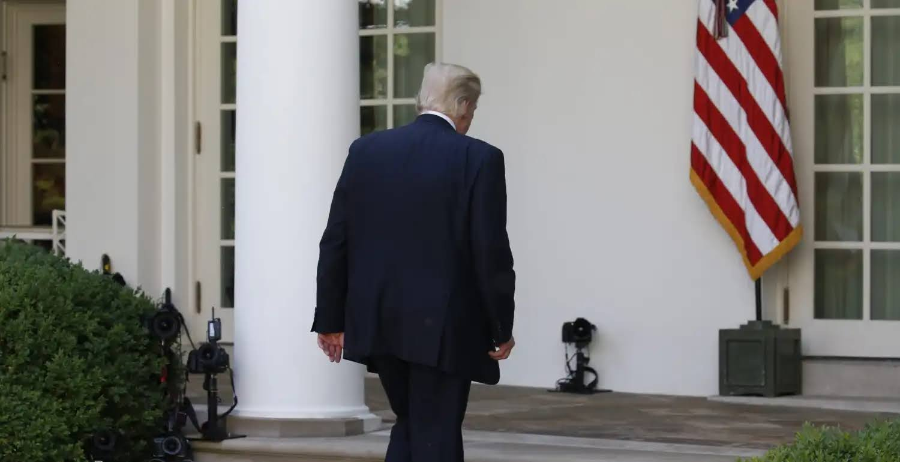

# DJT

*2026-10-04*

The war in Ukraine and the war with Iran will not end before the next U.S. presidential election. It is a disgusting zeitgeist.

Donald Trump does not have dementia, but he behaves as though he does. You cannot expect a coherent deal from someone who seems to forget, fifteen minutes later, what he was just discussing with another person.

For the past several years, the U.S. government has seemed to operate through a combination of bizarre decisions by deranged politicians and the autopilot of increasingly precarious bureaucrats. Donald Trump’s hallucinating mind is impossible to make sense of. It is immoral, incoherent, and repulsive.

