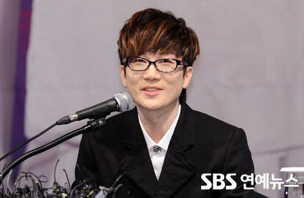

## Seo Taiji Is South Korean Pop Culture’s Most Dangerous Unknown in 2026

***The artist who repeatedly defied public expectations and redefined K-pop has released no new album in 12 years.***

On April 11, 1992, Seo Taiji and Boys received a score of 7.8 out of 10 on an MBC program introducing new singers. The judges were unimpressed by I Know, but the public disagreed. Seo went on to challenge rigid schooling with Classroom Idea and clash with Korea's music censorship system over Regret of the Times. A high-school dropout had become a star without following the establishment's rules. Was Seo Taiji ever one to play by the rules?

Thirty-four years later, Yang Hyun-suk, who once shared the stage with Seo, has built an agency founded in 1996 into YG Entertainment, listed on KOSDAQ in 2011. Alongside SM, JYP, and HYBE, it helped develop the machinery of modern K-pop: talent scouting, training, production, and global distribution. BTS topped the Billboard Hot 100, while BLACKPINK became the first Asian act to headline Coachella in 2023. K-pop is now a global industry that competes across continents and influences the earnings of publicly traded companies. Seo did not design that industry, but he helped establish the youth music culture from which it grew.

Success, however, brought new rules. Today's idols are musicians and the centers of major investments. Agencies spend heavily on production and depend on concerts, merchandise, and advertising to recover their costs. Without this system, K-pop's global success would have been difficult to achieve. Yet the greater the investment, the more carefully companies must manage the risk of failure. What if Seo debuted in 2026? Television judges misjudged his music in 1992. Would today's agencies, investors, platforms, and fandoms do any better? An industry that excels at producing global stars does not necessarily excel at recognizing unfamiliar musical possibilities.

Meanwhile, Seo has moved away from its center. His last studio album, Quiet Night, appeared in 2014. In his Christmas message in 2025, he expressed regret that he had no new music to announce. Instead, he described advances in autonomous driving, a childhood dream, as the year's happiest development. He wondered how AI would shape children's futures and recalled laughing with his family when one of his old songs appeared in a television drama. A child actor who participated in his ninth album is now old enough for college, and his own daughter has grown considerably. The young man who once reshaped South Korean pop culture is now a middle-aged father watching his music reappear on television and wondering about his child's future.

Those twelve years were not simply an artistic void. Seo has lived, traveled, raised a family, and watched technology transform the world. Meanwhile, K-pop became a global industry, popular culture grew increasingly multipolar, and music production and distribution changed dramatically. Yet these developments have never met in a new Seo Taiji album.

A return to the center of popular culture seems unlikely. Many Koreans in their twenties and thirties never experienced his heyday, and K-pop now belongs to a worldwide network of artists and companies. But commercial relevance and historical importance are different things. His distance from the industry makes his artistic evolution harder to predict. We do not know what he thinks of today's idol system, what music he enjoys, or whether he wants to engage with the industry he helped make possible. Neither the Seo of 1992 nor Quiet Night tells us enough about what might come next.

Modern K-pop knows how to discover young talent and turn musicians into global stars. That does not mean it knows what an artist who helped shape its foundations should create in middle age. Seo might neither challenge the industry nor pioneer a new genre. He might simply make music he likes. But if that music sounds nothing like contemporary K-pop, would dismissing it as outdated be enough? A system designed to produce successful stars is not necessarily equipped to understand the evolution of an artist who predates it.

