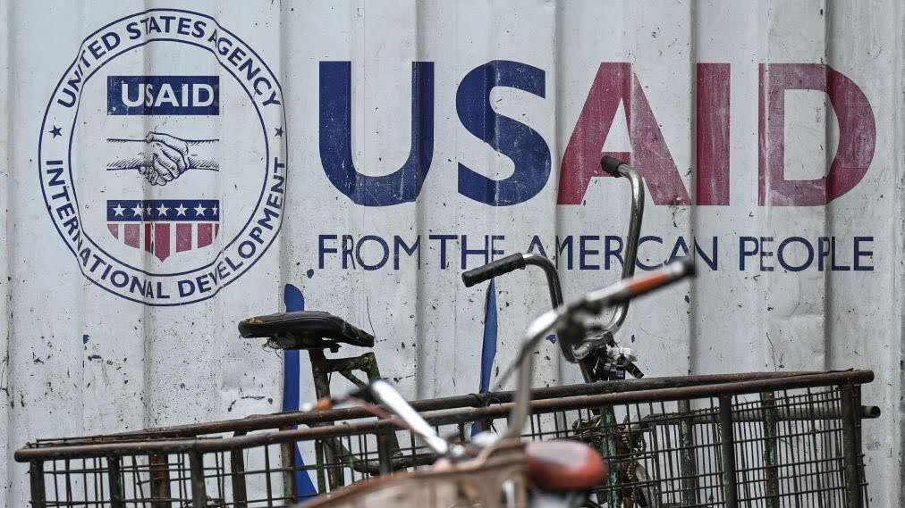

There will be no such thing as universal basic income in the future. To borrow the language of Elon Musk, the former head of America's Department of Government Efficiency (DOGE), it would be nothing more than a fraudulent scheme to steal money from the ordinary American people.

The floods that struck Nepal last summer demonstrated just how severely developing countries' ability to respond to climate disasters can be undermined in the absence of USAID assistance. For decades, the American government has failed to help countries like Nepal develop the institutional capacity to stand on their own.

And now, we have a president in Washington who dismisses global warming as a hoax and has withdrawn from the Paris Agreement.

