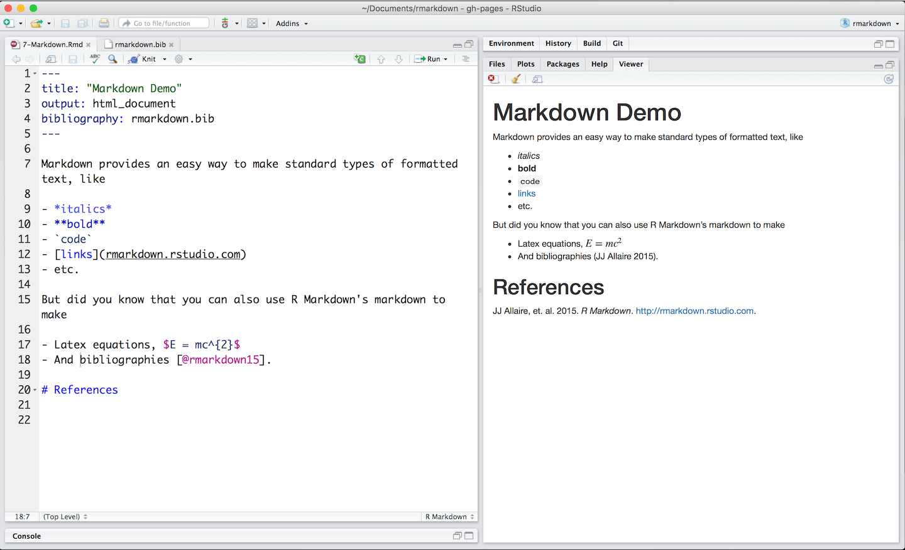

# AI-style writing

*2026-11-05*

I think AI is worse at writing than humans because it thinks differently from us. I was never a particularly diligent student at university, so I don't have an intuitive understanding of transformers. Still, I believe it is worth studying how AI decides where to place words and paragraphs. This is because, whenever I use an AI like ChatGPT Astra, I find the following prompt consistently useful:

---

Hey, ChatGPT. Think about this idea concerning writing.

AI-style writing: A variable simply appears out of nowhere → the variable gets used → but AI is smart enough to figure out what the variable means just by looking at how it's used → "Haven't I explained enough?"

Human: No, what the hell is this? It has not appeared before this moment! Find every instance of this problem in your writing and fix it. Humans read sequentially.

---

In fact, whenever I raise this issue and ask AI to produce a revised version, I find that sentences I previously struggled to understand are now presented with the context necessary to make sense of them.

Is better writing a matter of establishing premises and building arguments upon them in a logical sequence? Or is it better to design the way words and concepts function within a text non-sequentially, allowing readers to experience the writing rather than merely follow its arguments?

Such writing would be difficult to understand if read sequentially. But it would also allow us to compress the greatest amount of meaning into the smallest possible space. Perhaps AI isn't actually bad at writing. Perhaps it is humans who read and understand things inefficiently.

