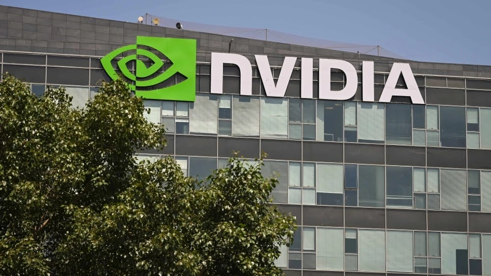

## Nvidia Is Not Jensen Huang

*Jensen Huang has shown disastrous judgment in his dealings with China. The time to begin planning for his succession is 2026.*

Jensen Huang is one of the most successful business leaders in history. He founded Nvidia in 1993 and transformed a graphics-card maker into an indispensable supplier of infrastructure for the artificial-intelligence industry. His long-term investment in CUDA exemplifies his remarkable judgment. More recently, he has turned Nvidia into a financier of the AI boom, taking stakes in customers and underwriting demand for their computing capacity. And his success continues. In August, Nvidia reported quarterly revenue of $96.2bn, up 106 per cent from a year earlier.

Huang’s influence extends beyond Silicon Valley to Washington. His signature black leather jacket fetched $960,000 at a Sotheby’s auction in July. President Donald Trump appointed him to the President’s Council of Advisors on Science and Technology in March and seated him immediately to his right at a White House dinner for AI executives in September. Huang’s political influence has been particularly consequential in US policy towards China. He has pushed for looser restrictions on exports of advanced AI chips to China, and earlier this year the Trump administration moved to allow exports of Nvidia’s H200 chips under certain conditions.

But the recent revelations about Huang’s extramarital affair raise a troubling question: has his judgment in managing the risks of doing business with China been that of a rational executive? Huang has admitted to an affair, and US intelligence officials suspect that the woman involved, Alice Huang, has ties to Chinese intelligence. Megaspeed, where she previously served as an executive, is an Nvidia customer that has been investigated over suspected violations of US chip export controls and has also received loans from Nvidia. There is no evidence that Huang knew of any espionage or granted improper favours. Yet the relationship placed his private life dangerously close to Nvidia’s most politically sensitive business.

The costs of that judgment could grow. Having regained control of both chambers of Congress in the midterm elections, Democrats could demand stricter oversight of data-centre construction, cybersecurity and AI safety. Calls for tighter restrictions on advanced technology exports to China can be heard in both parties. What if Democrats also win the White House in 2028? Huang spent years building his influence in Washington. The scandal has undermined the very credibility on which that influence rests.

How prepared is Nvidia for such risks? More than 60 executives report directly to Huang, who remains deeply involved in technical decisions ranging from GPU architecture to memory and networking. This management structure has produced extraordinary results. Yet after 33 years at the helm, the founder still has no publicly designated successor. Nvidia’s problem is not that Huang can make bad decisions. It is that the company may struggle to replace him even when circumstances demand it.

An independent investigation into the allegations is still under way. But Nvidia need not wait for its findings to begin succession planning. The company is still growing, and it has the time and resources to develop future leaders and distribute authority. This scandal has provided a reason to begin reforms that could long be postponed. Huang does not need to be fired today. But Nvidia must be able to fire him.

