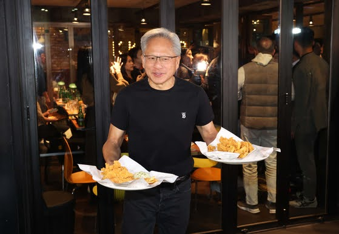

## The End of Washington's AI Innocence

*Jensen Huang’s scandal marks the final chapter of Washington’s innocent optimism about AI, born in an era when the technology was still fragile and needed nurturing.*

This week’s leader in The Economist reminds me of an essay I wrote just a few days ago. I never imagined events would unfold this way. Jensen Huang embodied a certain naive optimism about AI. Perhaps humanity is no longer inclined to view the future that AI promises in purely positive terms. Huang’s greatest miscalculation was to underestimate how much the politics of AI had changed. He continued to present its global spread as a promise of shared prosperity, even as Washington increasingly regarded access to its most powerful hardware as a matter of national security.

*https://www.economist.com/leaders/2026/11/11/jensen-huang-must-resign*

In the 1990s, Nvidia invested in quadratic-surface rendering, a technology for representing curved surfaces. But the PC graphics industry standardised around Direct3D, which relied on triangular polygons. Nvidia eventually changed course and returned to the market with the RIVA 128 in 1997. The lesson Huang may have drawn from that experience was a powerful one: *if my judgment proves wrong, I can simply develop better technology and prove myself in the marketplace.* But Washington operates by a different logic. Political trust, once lost, cannot be restored through technological innovation. Sometimes, rebuilding it simply takes time.

AI-assisted cyberattacks are becoming increasingly common around the world. Prominent researchers, including Geoffrey Hinton, have warned about the consequences AI could have for human civilisation. Anthropic’s IPO filing, released in October, even explicitly acknowledged the possibility of AI causing human extinction. Huang, however, has dismissed such concerns about AI safety as little more than an "apocalyptic narrative". He may yet be proved right. But others need not agree, and many of them have the power to shape Nvidia’s future. Had he taken those warnings even a little more seriously, he might have approached his business dealings with China more cautiously. For years, lawmakers in both parties had sought tighter controls on advanced-chip exports to China, wary of the dangers that might accompany AI’s extraordinary power.

Washington had been growing wary of AI long before Huang's scandal. Yet Huang remained one of the most compelling voices of an earlier optimism. The future he imagined is still possible. It is harder now to believe in it quite as innocently.

**링크**

- [Jensen Huang must resign](<https://www.economist.com/leaders/2026/11/11/jensen-huang-must-resign>) — And his should not be the only head to roll
