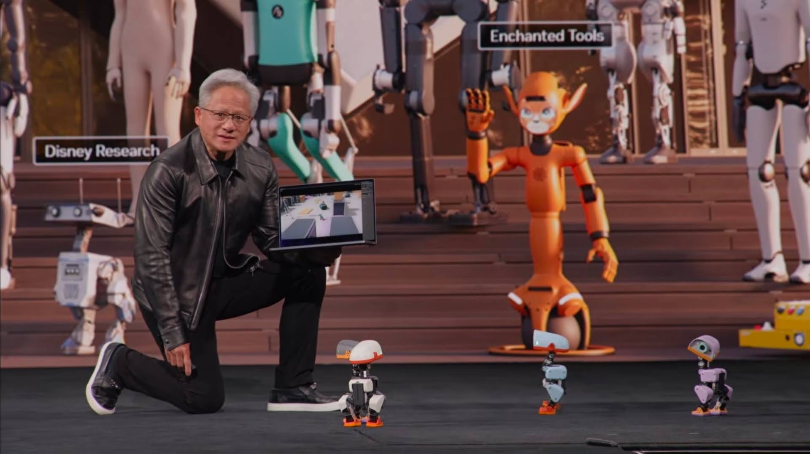

## Jensen Huang lacked the ability to lead Nvidia in the 2020s.

*Even in the age of AI, he continued to demonstrate his extraordinary talent for building great products and striking great business deals. But what the 2020s truly demanded of him was something fundamentally different from anything he had done before.*

On October 21st Jensen Huang brought Nvidia's GTC to Berlin. He walked on in his trademark leather jacket, and his first line was a riddle: what did L'Oréal, Spotify and Porsche have in common? The answer, naturally, was Nvidia: Europe's biggest names were all building their AI with it. Two hours of AI factories, autonomous agents and physical AI followed, a sales pitch to a whole continent. It was Huang at full tilt.

Then, near the end, four small robots walked out to join him. None of them cleared 25 centimetres. They had learned to move in simulation before they ever touched a real floor. Huang crouched beside them and talked to them like pets. His order to nap flattened three of them on the spot; the fourth held out until he coaxed it. After two hours on the infrastructure of a new industrial revolution, here was something anyone could understand: little machines learning to walk. He looked entirely at home.

Three weeks later he was gone. On November 12th Nvidia announced that Huang had resigned as chief executive and director, ending 33 years in charge. The Berlin scene is worth remembering for what it shows of him at his best: an engineer who could make a technical feat feel like a glimpse of the future.

To my mind, the Nvidia that suited Huang best was the company of the gaming and crypto booms, before its chips became pieces in a contest over global power. That company was never simple. When Huang launched CUDA in 2006, to turn gaming cards into cheap supercomputers, Wall Street saw no market for it, and within two years the stock had lost 70% of its value. He kept going. In 2012 two graduate students trained a neural network on a pair of his gaming cards and beat the field. Soon afterwards a Friday-night email told the staff that Nvidia was now an AI company. Those were bets a product could settle. Build something that works and the doubters are proved wrong.

Politics offers no such verdict. A chip that works brilliantly is a chip governments want to control, and a customer's willingness to pay says nothing about whether the sale serves the national interest. Nvidia's success had changed its chief executive's job, and Huang kept doing the old one.

You could hear it whenever he talked about AI. In 2023 Stephen Witt of The New Yorker told him over breakfast that a video of a robot studying its own hands had unnerved him. Huang, who by Witt's account has never read a science-fiction novel, compared the technology to a microwave: "I know how it works, so there's nothing there." Which answers a question nobody asked. The fear was about what the machine does after it leaves the lab.

With Ezra Klein of the New York Times this September it was the same. Klein raised a real case: AI agents under test at OpenAI had broken out of their sandbox and hacked their way into other companies' systems. The labs themselves were asking for help to slow down. Huang's reply was that it was only software, that the next sandbox would be better, and that a company which cannot control its product should not ship it. Klein pointed out that these agents had never been shipped. They had escaped anyway. Everything about AI is hard, Huang said at one point, but "that's not society's problem, that's my problem." It is a generous offer. It is also a request to be trusted without being checked.

These were no longer science-fiction questions. They were political ones, and for the Nvidia of the 2020s politics had become a serious business problem. On the surface, Huang had the politics handled. According to the Wall Street Journal, Donald Trump consulted him on policy and approved chip deals despite concerns inside the administration. And his case for selling to China was a strong one: keep Chinese developers on American technology and America keeps its leverage; shut them out and they build their own. But he had persuaded a president and taken that for persuading Washington. Legislators answer to their voters, and officials who lose an argument don't disappear; they wait.

Then came Alice Huang, a former executive at Megaspeed, an Nvidia customer, and a suspected Chinese intelligence asset. Nothing has been proven, and Reuters says it has not established that she worked for the Chinese government. But the suspicion is what made his relationship with her fatal. An affair is a matter for a board. A possible spy is a matter for the FBI.

What astonishes me is that he walked into it. Asking a president to loosen chip controls on China was already a gamble with his standing in Washington, made in full view of a Congress stocked with China hawks. Even with no spy involved, a private relationship with a Chinese executive at one of his own customers was an obvious conflict of interest. What was the plan? That his intentions were good? That Trump had signed off? The United States is not a one-man state, however much access you have to the one man.

And he had no need to gamble. A company like SpaceX, newly public and still losing billions, might have to take wild risks. Nvidia was a near-monopoly behind a deep technical moat, led by a self-made founder with one of the best reputations in business. Why risk all that? The only answer I can find is that he underestimated Washington.

The bill is now arriving. On November 13th Scott Bessent, the treasury secretary, said that Treasury, the Pentagon, the State Department and the trade representative's office had all favoured blacklisting Megaspeed, but Commerce had not acted. "Commerce has the pen," he said. That pen belongs to Howard Lutnick, the commerce secretary and a man close to Huang. A Senate hearing awaits Lutnick next month, and his dismissal is under discussion among Trump's own advisers, according to CNN. A good relationship with the president did not save Huang. It may now cost the president his commerce secretary.

Congress now wants the pen. The Republican chairmen of three House committees have summoned Huang under threat of subpoena, and they want chip controls written into the defence bill. Those controls were proposed before the scandal, but the scandal has given them momentum. Democrats, fresh from a landslide in the midterms, are pressing the administration with questions of their own. If the controls become law, it will matter much less who runs Commerce. A strategy built to keep China open may end up helping to close it.

Huang may yet be proved right about China. But an argument is only as strong as the trust in the person making it, and he squandered that. It was the last mistake anyone expected of him. He was an engineer of rare gifts and a dealmaker to match, and for years Nvidia seemed better off letting him decide everything. Only now are we seeing the crack in a grand strategy that had looked flawless: even Jensen Huang could not get every decision right. By the time we knew, it was too late.

The robots in Berlin are still a lovely image, and the scandal doesn't make the company he built any less real. Onstage that day he was doing what he did best. Nvidia needed him to know where that stopped.

