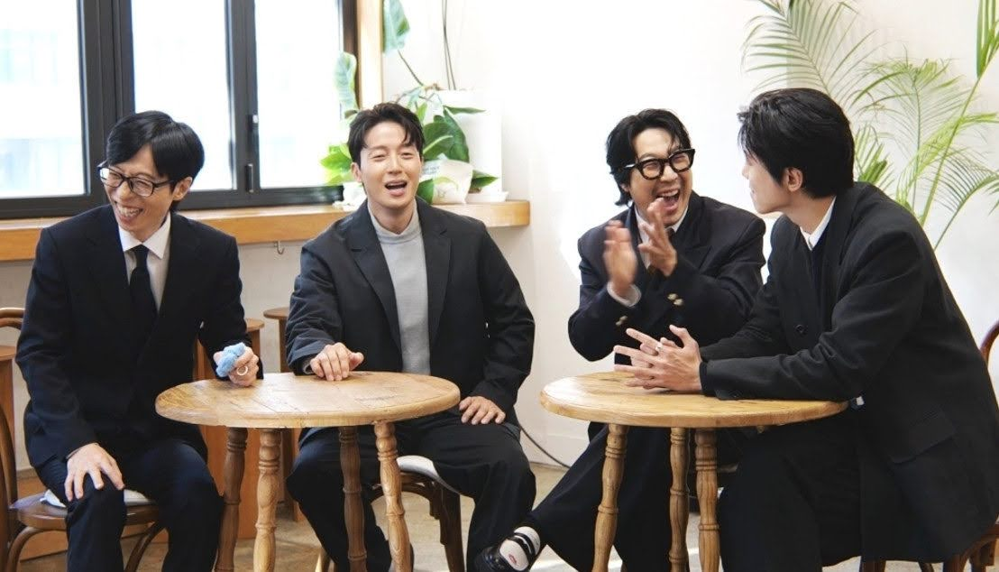

## When the right answer becomes free

*Ahead of the suneung, South Korea's college-entrance exam, the government is rushing to tighten its rules on AI hardware. But hardware is not the real threat to this year's exam.*

On the morning of November 19th, 550,000 candidates will take off their glasses before they are handed an exam paper. Invigilators will inspect each pair, and look again at the start of every period. Stickers will go over the buttons on candidates' clothes. Bags will go out into the corridor, and an emergency alert will be sent to make any hidden phone ring. A country that already grounds aeroplanes for the English listening test is, this year, sealing buttons.

The exam matters this much because of what lies on the other side. The suneung decides who goes to which university, and the university goes a long way to deciding who works where. Large companies pay an average of 7.16m won a month, small ones 3.51m; over a lifetime, the gap between starting at one or the other comes to more than 1bn won. That is why 35.6% of this year's applicants, the highest share in 31 years, are not schoolchildren at all: most are back for another attempt. The suneung does not reduce this inequality. It makes people accept it: same questions, same day, same clock. That acceptance rests on a single assumption: that inside the exam hall, the right answer can come from nowhere but the candidate's own head.

This autumn the assumption broke in under three weeks, albeit in a different exam. On October 28th the results of the certified tax-accountant exam were published. The top scorer had 397.5 points out of 400, a mark high enough to arouse suspicion. It settled on smart glasses, and the education ministry announced that merely carrying a pair into the suneung would void a candidate's result. On November 15th the top scorer went on YouTube and confessed: he had photographed the questions with a miniature camera, sent them to an AI and read the answers off a smartphone. There were no glasses. Such cameras are often sold disguised as buttons. Two days later the government unveiled its stickers.

The camera is not new. A ring broken up in 2013 for cheating on the TOEIC, an English-proficiency test, already had collar cameras, in-ear receivers and smart watches. It needed one more thing: an English teacher who would sit the test as a candidate and work out the answers. Clients paid 2m-4m won each. In 2024 a candidate for Japan's Waseda University photographed the entrance paper with camera glasses and sent it out. It was not an invigilator who caught the cheat but the person asked for the answers, who reported it. People who knew the right answer were scarce, they were expensive, and they did not always keep quiet.

In 2026 that person is no longer needed. On September 6th an AI model scored 450 out of 450 on last year's suneung, in an unofficial test run by a university student. The tax accountant's confession features a camera, an AI and a smartphone, and nobody else. The hardware is 13 years old. What is new is that the answer no longer has to come from a person. The right answer has become free.

Inside the exam hall, the government can win this fight. A hall is a closed room, and a closed room can be sealed. But the hall is the only thing it can seal. When the exam is over, the candidates walk out into a world where the right answer is free. Fewer jobs are waiting for them there. According to the Bank of Korea, the number of young people in work fell by 285,000 over the past four years, and 94% of the losses were in industries highly exposed to AI. The fewer the jobs left to hand out, the fiercer the argument over who deserves them. If finding the right answer was once what separated a recruit at a big company from one at a small firm, what will separate them now?

Not their answers. When the right answer is free, the person who understands it gives the same one as the person who does not. Employers want to know which of the two can actually do the job, and an answer no longer tells them. For decades every job application has opened with a self-introduction essay. Now more than nine in ten job-seekers use AI to write it. This autumn SK Hynix, a chipmaker, dropped its essay questions; it asks applicants instead to describe their work with AI and their technical expertise, and puts them through a half-day interview. But there is a simpler proof: a record. Of the graduates big companies hired as "new" recruits, the share who had already worked elsewhere rose from 22% in 2022 to almost 29% in 2024. A record cannot be generated. It can only be built up, and only by those who have already been given a chance. More and more, what separates one candidate from another is time.

South Korean television shows where that rule may eventually lead. In October 2012, on the 300th episode of "Infinite Challenge", Yoo Jae-suk, the country's most popular entertainer, told two younger castmates: "Maybe I'm the one keeping you from showing everything you can do." Their time would come, he said. That was 14 years ago. Yoo topped Gallup Korea's annual entertainer-of-the-year poll that year and has topped it every year since. Meanwhile "Gag Concert", the weekly sketch show that served as comedy's exam, has gone from ratings near 40% to around 2%, while the long-running variety shows stayed on and their casts grew older with them. The seven regulars on "Running Man" now average 47.

South Korea's job figures are starting to look like its television. In the same AI-exposed industries that shed young workers, the number of people in their 50s in work has risen by 173,000. Even when the right answer is free, the inequality remains. The reason people accepted it does not.

