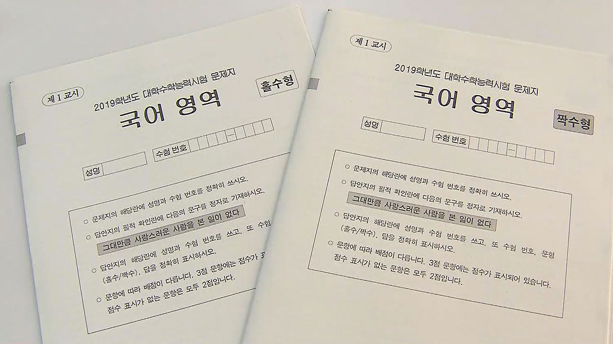

## South Korea will beat the AI cheats

*2026-11-18*

*Whether that saves the suneung from AI is another question.*

People have questioned the format of the suneung for a long time. The exam has changed gradually, in step with each revision of the national curriculum. Until now the argument has mostly been about what it should cover. When I sat it in 2020, for example, candidates bound for humanities and for science degrees took different maths papers and were ranked in separate pools. From the following year that division was gone, and the mix of topics on the paper changed considerably. But these periodic changes never went beyond fine-tuning. The format itself stayed: pick one of five options or, in maths, arrive at a number that has already been decided.

Suneung scores matter so much for university admission that teachers build their lessons around the exam. In my experience, school midterms and finals closely follow its format too. Some of the grading is done through coursework instead, but even for school grades a written exam has been regarded as the fairest way to separate students. So changing the suneung's format is not just a question about the suneung. It means redesigning what high schools actually teach.

I think that in the short term the government will try to keep the current format, and its chances are better than they look. It can bring criminal charges against anyone caught cheating. It can screen for electronic devices more aggressively than it does now. Remember that South Korea's education system managed to hold the suneung in the middle of the covid-19 pandemic. It also has every reason to try, because if the format cannot be kept, a much harder problem awaits. Would written answers really make the exam fairer? Can't AI write those too?

The real question is what doing well on the suneung will be worth. Selecting people by exam can certainly be fair. But does a gap actually show up at work between those who passed and those who did not? Advances in AI are making that harder and harder to answer. Since OpenAI's o1 appeared, computer-science assignments have been losing their power to tell students apart, because everyone can now do them with AI.

Suppose AI is better still in two or three years. Will companies still be able to tell the productivity of someone who did well on the suneung from that of someone who did not? Does it still hold, in the age of AI, that hiring good exam-takers means hiring productive people? Or companies may stop relying on exams and hire through personal connections instead. If so, it will become even harder to justify how they select people by an appeal to fairness. If AI makes real ability hard to distinguish, the crisis of the exam as a format will deepen, however fair the exam is.

