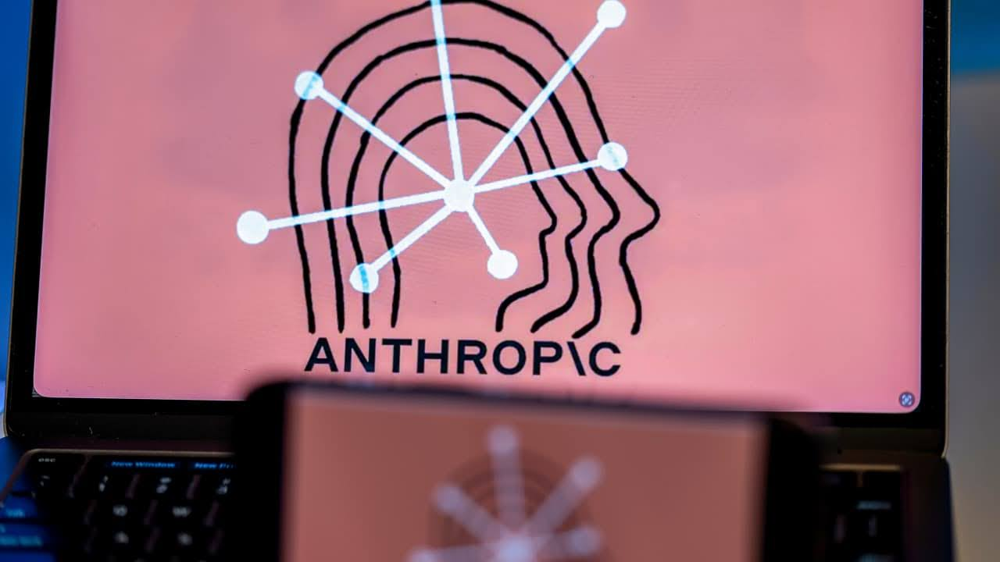

## The next CEO to fall over AI

RSI is coming. In 2027, the economic importance of the AI alignment problem will be greater than ever. How much longer can Anthropic keep releasing models the way it does now, when it can't understand them but their capabilities are growing exponentially? After Jensen Huang, we may soon see a second AI industry CEO ousted.

