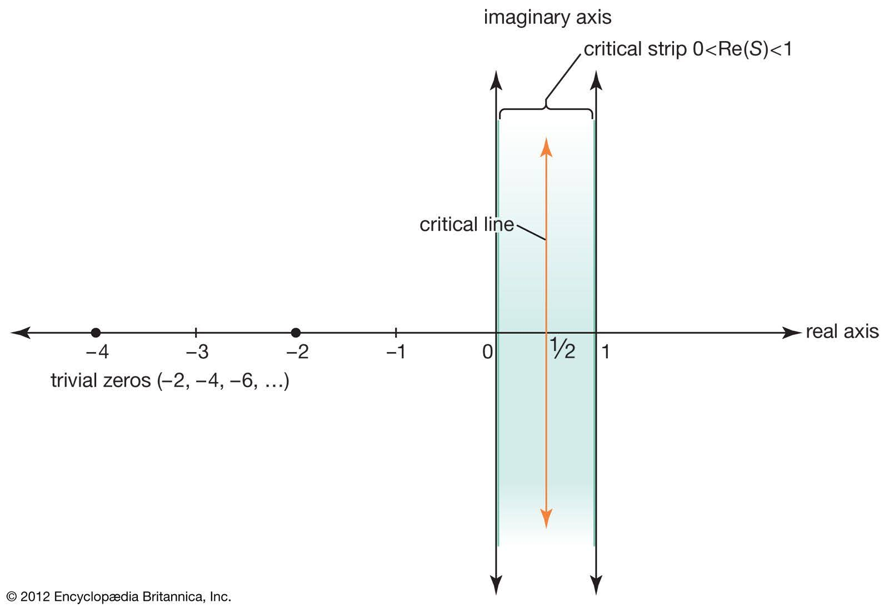

## RH solved

*2026-11-25*

Either AI will substantially advance human mathematics, or proving the Riemann hypothesis is in itself of limited significance. At least one of these propositions must be true.

Does advancing human mathematics benefit the human mathematical community? Could a company possessing AI powerful enough to revolutionise mathematics nevertheless reap only limited benefits in the long run?

